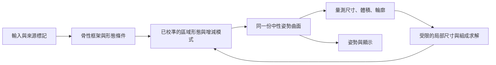

# BodyRef 整合重做計畫：形態、尺寸與組成共用受限的表面控制

日期：2026-10-21。狀態：完整實作交接規格；本次只完成文件，新的實作尚未開始。

本計畫依據作者的完整需求、兩輪失敗交接、main 原始碼與歷史、實際 before／after 圖、既有 Seamscape 對照，以及本次核對的解剖與計測來源整理。這次只讀取資料、整理計畫與保存文件分支；未改應用程式、啟動人體測試或預覽、合併、部署。

## 1. 建議採用的決策

**從已回滾的 main 重新開始，保留有效的截面圈與原網格，加入經造型校準的局部控制及關鍵形態；尺寸求解只能使用這些經檢查的形變模式。體脂、去脂組成與骨性框架會改變模式本身，而不是完成尺寸後再疊加一層變形。**

三個部位階段全部納入交付：女性腰腹／後腰—臀—大腿根、女性基礎胸型、男性胸腹背臀。共同的量測、組成與控制介面在第一階段之前建立，各部位做完即接入驗證，最後再做全身整合。

本交接計畫把比例 `1 : 比值` 排成獨立的小交付 R，於本輪結案前完成；這是本計畫對先前待辦排程的安排。骨盆寬新介面、InBody、命名胸型及輸出功能維持後續範圍。

### 版本處理

- 重做基準：main `7615057`；應用程式與 `f4e2aff` 相同，本次已核對 src、public、套件、測試與 workflow 無差異。
- 保留 `6ed45cb` 第一輪已有效的分配及臀部改善，原版仍有的問題則逐項修正。
- `8a737e8` 已撤銷；PR #7 未合併；`81abd7a` 與目前未提交工作樹都只保留為失敗證據，不整批帶入新分支。
- 目前工作樹的部分 README／HANDOFF／計畫有過時的通過描述。正式接棒文件以乾淨 main、本計畫及 [開發歷程中的兩次失敗紀錄](HISTORY.md) 為依據，實作時重新同步狀態。

## 2. 兩次失敗對這次設計的實際約束

| 已發生的問題 | 這次必須改變的做法 |
| --- | --- |
| 把研究中的「扇形、附著、脂肪覆蓋」直接翻成手寫凸起公式 | 研究先決定區域及連接；在自有網格製作並檢查實際曲面後，才確定控制幅度與尺寸響應 |
| 新 84 點控制網平滑、零輸入不動，非零輸入仍變方、變尖 | 同時驗收中性、增加、減少及中間狀態；不以控制點數、插值連續性代替形態驗證 |
| 臀圍正確，正面寬度與大腿輪廓卻退步 | 驗收必含正面側輪廓、背面、斜視與連續高度的截面；周長不能代替寬深分布 |
| 完成形態後以整圈 X／Z 縮放湊尺寸，破壞原先曲率 | 保留方向不同的截面響應；尺寸校正也只能沿已校準的局部模式，不另加無限制的整體收縮出口 |
| 胸部靠擴大負值、切掉深度或放大球面求周長 | 先有合格的小、中、大胸曲面與根部關係；尺寸只在這些模式內求解，根部與自由表面分開處理 |
| 多部位、分配、量法、顯示平滑同時變，無法找原因 | 每個候選保留「只改形態／再接尺寸／再接分配」三個對照，量法和顯示處理另有獨立差異 |
| 自動推估體重回饋成肌肉條件，造成意外全身變形 | 輸入記錄手動、統計推估與輸出三種來源；輸出的推估重量不再當成新的實測肌肉證據 |
| 44 個測試通過就宣稱改善，後來 34／44 且逾時 | 數值、外型、效能分別記錄；同一份報告固定同一份程式與資產，禁止跨版本挪用通過紀錄 |

本次已檢查前後與隔離對照：E90／H130 的候選版出現更窄且有稜角的腰臀腿連接；T5-125 有明顯肩胸折痕及垂袋形變。原版大胸也有不足，但不能以此接受新增缺陷。關閉自動組成後問題仍在，不能把全部退步歸給單一肌肉形變。圖像證據留在倉庫外，這裡保留可重現案例與結論。

## 3. 與作者「雙控制」想法的對應

以同一個表面函數表達：

`S = F(b, c, p)`

- `b`：身高、四肢比例、胸廓／骨盆等骨性框架；未要求改骨架時保持原框架關係。
- `c`：脂肪覆蓋、肌腹飽滿與分布等形態條件，決定截面輪廓、最飽滿位置、支撐範圍與交界形狀。
- `p`：沿該形態調整大小、局部量體的控制量。
- 手動圍度是對最終 `S` 的量測限制 `M_i(S) = t_i`，不是某個圈的縮放倍率。

`c` 改變時，`p` 的位移方向、作用範圍及體積響應也更新。兩個控制方向有交互，但共用同一個表面與同一套限制。

**例：腰圍固定 68，體脂從 18% 改為 35%。** 腹前、腰側、後腰與下腹的覆蓋和飽滿位置先依形態條件改變，再於允許的控制中維持 68 的周長。固定的是皮尺讀值，不是腰部頂點；這個區域的形態、體積與組成帳都重新計算。若也固定體重，其他區域須在同一輪分配中回應，而不是最後把誤差塞給手臂。

同理，臀圍從 104 改到 114，所用的增量模式可以隨肌脂條件不同而改變側寬、後翹與下部飽滿的比例；不會永遠是同一顆圓頂加高。

「形狀骨」在現有程式中主要是截面圈、方向縮放、曲線及區域位移。這次沿用這個概念增加局部造型控制；不把它誤認為已存在完整的解剖骨架，也不另做人體內部的物理模擬。

## 4. 選定的技術路線：原截面主幹＋區域控制＋自有關鍵形態

### 4.1 哪些保留，哪些重建

保留原網格拓撲、姿勢骨架、有效的 PCHIP 截面連接、前後內外方向不同的尺寸響應，以及第一輪可接受的臀部曲線。新增控制先作為局部增量；尚未接管的區域維持基準行為。

重新設計腰臀腿交界、女性胸部附著與自由表面、男性胸部模式，以及組成到這些模式的驅動。局部控制與關鍵形態共用一份表面，不讓舊凸起、新凸起與原生胖瘦形變各算一遍完整增量。

不採用全身自由頂點最佳化，也不沿用整套 84 點網。HISTORY 已記錄「任意參數湊任意目標」造成異常部位連動；本輪維持區域責任與有限的相鄰交互。

### 4.2 每個控制必須具備的規格

1. 解剖／造型意義，例如臀側覆蓋，不只是一個座標編號。
2. 局部座標與父參照，例如骨盆、胸廓；不能以世界座標固定高度代替。
3. 可動方向及增減模式；平移、厚度、寬度、飽滿位置分別定義。
4. 作用頂點、附著邊界與過渡帶；用拓撲和結構標記建立，不單靠球形距離或最大骨權重標籤。
5. 與相鄰控制共享的邊界及切線；同一交界只合成一次位移。
6. 在不同形態條件下允許的範圍及校準依據。
7. 實際網格的尺寸、體積與輪廓響應，以及對應的驗證案例。

### 4.3 關鍵形態怎麼做出來

這是之前方案寫了、實作卻跳過的工作，這次獨立成必交付產物。

1. 從基準網格和現有 CC0 形變目標選取候選。資產已有男女胖瘦／肌肉，以及女性杯型／挺實度目標；它們可供造型起點，不當成人體實測的標準答案。
2. 在同一拓撲上標記骨性參照、附著區、活動區與交界曲線。用局部控制調整關鍵點及截面輪廓；保留原表面的細節差異，避免把整區重新換成球面、橢球或柱面。
3. 以原網格為底，製作少量代表狀態。女性腰臀先做中等臀、大臀、固定大腿圍的大臀，並加入同尺寸高低體脂。女性胸部先做正常 B／E 及小胸廓 E，再延伸既有大罩杯。
4. 每個狀態同時看完整人體、局部多視角、截面及控制熱圖。記錄哪些部位應改、哪些應維持；拒絕任何把大腿拉方、挖出後腰脊稜或製造肩胸折痕的候選。
5. 保留通過檢查的自有頂點差值／控制曲線，作為可插值的關鍵形態。對組合操作加入必要的自有修正形變；不能只證明每個單一操作正常，便假設組合一定正常。
6. 檢查關鍵狀態之間的中點及連續掃描，確認輪廓沒有過衝、突然換峰或縮陷，再把模式交給尺寸求解。

可利用既有 Python 資產流程離線產生權重、局部形變及標記資料；不以安裝 Blender 或要求作者自行雕刻為開工前提。離線製作仍須反覆看實際網格，不能把「有產生檔案」算成造型完成。

這些關鍵形態是控制函數的校準節點，不是讓使用者只能選幾種固定體型。尺寸仍連續可調；現有支援範圍中的大尺寸需要補足節點與模式，不能用未校準外插代替。

### 4.4 如何把尺寸接回去而不再次壓壞造型

每次求解從相同輸入的確定起點開始，流程如下：

1. 依輸入來源建立骨架、形態條件及區域量體的初值。
2. 建立候選曲面，量測真正皮尺路徑、體積、必要輪廓特徵。
3. 只開放與目標區域及必要交界相關的模式。例如臀圍只用臀後／側／下與腿根的聯動，不用胸、肩或小腿湊數。
4. 對少量控制求受限步長；手動尺寸和指定總量是硬條件，未填尺寸的統計偏好是軟條件，外型有效範圍則限制可接受的候選。
5. 每個候選重測硬條件，並拒絕超過已校準範圍、引入交界故障或明顯破壞目標輪廓的步驟。單純讓誤差更小，不足以接受。
6. 形態或作用區有實質改變時，更新相關控制的尺寸／體積響應；不沿用過期切線，也不每一步重建全身所有控制。
7. 收斂後重新搜尋最細腰、臀部相關最大截面等量測位置，避免只在舊高度湊出正確數字。

硬條件與造型有效範圍同時無法滿足時，開發端定位缺的是哪個模式、量測或分配能力。一般 E 案例必須列為模型故障回歸，不能顯示成生理不可能。也不能暗改使用者指定值或把失敗模型部署後再解釋。

## 5. 三個部位階段的具體改動

### 第一步：女性腰腹、後腰、臀部與大腿根

這一段以一個相連的區域處理，優先級最高。

| 控制群 | 改什麼 | 必須保住的關係 |
| --- | --- | --- |
| 腰側、腹前、下腹 | 同圍度下的寬深分布、飽滿高度、覆蓋過渡 | 收腰不等於整圈等比縮小；下腹不出現局部切口或尖錐 |
| 後腰、骶骨旁、臀上 | 腰窩深淺與過渡距離、臀上承接 | 不靠挖低脊柱兩側製造凸起中線；中線也不是整條僵硬固定邊 |
| 臀後與臀上 | 後投影、飽滿位置、上下作用範圍 | 保留第一輪有效曲線，大尺寸不變獨立球塊 |
| 臀側、轉子周邊 | 正面假胯寬及向臀後的連續覆蓋 | 軟組織變化不強迫骨盆骨架一起變寬；側臀不只增加後方周長 |
| 臀下、腿根外側與後側 | 下部弧線、臀下回接、向大腿的延伸 | 臀下褶不畫成橫向切線；不能靠整條大腿加粗換取連接 |

主幹仍採方向不同的截面輪廓。接近胯下分叉處改用左右腿根各自的局部座標與共享過渡，避免把軀幹與兩條腿塞進同一圓柱控制域。

增臀圍時，預設模式共同調整側寬、後翹及下部過渡。高脂覆蓋與較飽滿肌腹使用不同的組合曲線；研究只提供結構依據，具體寬深比例由本專案的關鍵形態校準。

臀下褶的纖維附著研究支持它需要自己的交界控制，不能把它直接等同臀肌下界或一條固定水平切口。[MRI／解剖研究](https://pubmed.ncbi.nlm.nih.gov/33462737/) 與 [臀部皮下結構研究](https://pubmed.ncbi.nlm.nih.gov/36519643/) 用於界定這些關係，不提供通用增臀公式。

**這一步必交付：** H94／104／114／124／130 的正側後斜視；固定腰與大腿圍增臀的序列；同腰 68 的高低體脂對照；後腰、臀下與腿根局部截面。胸部不應因這一步出現新的形態變化。

### 第二步：女性基礎胸型

先修可靠的預設型與尺寸變化，再讓後續命名胸型選擇不同的形態設定。

- 胸廓、乳房根部及自由表面分別標記。最大骨權重標籤只能作提示，不能拿約一百多個 breast 標記頂點當作完整乳房邊界。
- 根部隨胸廓移動與變形；杯量增加時，前投影、內外側、上極、下極及飽滿位置一起走校準好的路徑。
- 上胸過渡、中央分離、腋側與乳下褶一起設計；不以「去掉尖角」或「圓一點」作為自然胸型的定義。
- 小胸以合格的小杯曲面為基準，不靠向後削掉大胸表面取得。大胸增加下部飽滿與作用範圍時，不能把整個根部向下拖成長袋。
- 胸壁與下胸量測分開核對：下胸尺應對應胸廓位置，不能環住下垂乳房，也不能排除過多頂點後量到缺損截面再誤放大胸廓。
- 乳頭顯示平滑單獨比較。會影響輪廓的幾何處理必須納入量測用的中性曲面，不能用不同顯示網格掩蓋尺寸錯誤。

[乳下褶研究](https://pubmed.ncbi.nlm.nih.gov/34998682/) 描述多層筋膜與周邊脂肪的結構，支持根部、下極與過渡分開控制；不把特定肋骨高度硬套成所有體型的固定座標。

**這一步必交付：** 一般 B／E、小胸廓 E、G 與既有大罩杯範圍；上胸 85／90／95／100、下胸為上胸減 20、腰 56／64、臀 104／114 的 16 組 E 回歸；T5-105／125。罩杯差依本專案現行定義，不能只靠字母比較不同量法。

### 第三步：男性胸腹背臀及全身整合

- 男性胸部拆成胸廓尺度、胸大肌形態與脂肪覆蓋三種來源，但在同一曲面中合成。
- 胸肌模式以胸骨、鎖骨、腋側連接及下緣界定作用區，校準厚度、寬度和肌腹分布；不把乳頭作為兩顆圓頂的中心。
- 脂肪模式處理前胸與外下側的連續覆蓋，增加胸圍不必與女性杯型共用模式，也不能把整個後背當作同等厚度的補償區。
- 男性腹前、腰側與下背沿共同框架改善硬轉折；臀部另有男性肌腹／覆蓋模式，與骨盆、骶尾和腿根接續。
- 回看女性兩步，確認共用分配、組成更新後仍保留原先已檢查的外型。

[胸大肌三維結構研究](https://pubmed.ncbi.nlm.nih.gov/19291757/) 用於肌腹與附著分區。胸肌呈扇形不代表皮膚上加一塊扇形凸起就完成胸型。

**這一步必交付：** 男性同胸圍的高低體脂／不同去脂飽滿模式、增胸圍序列、男性偏胖腹背與臀腿；男女固定多圍度後增重的整合回歸。

## 6. 組成與分配：先把帳和外表的關係定清楚

### 6.1 去脂量不直接改名肌肉量

指定體重與體脂時，可以建立脂肪與去脂總量；去脂量還包含骨、器官、水分等，不能全數分給肌肉，也不固定把新增去脂的 18% 塞入手臂。

本輪先完成現有體脂輸入、去脂量估計與區域形態的共同介面。肌肉形態是造型條件，數值來源要標明；未輸入真正骨骼肌量時，不宣稱已算出實測肌肉率。獨立肌肉量／率介面留在後續功能，但現在預留它能驅動同一套區域模式。

### 6.2 固定圍度的區域仍參與變形和記帳

- 對每個區域保存形態條件、允許模式及其量體變化；固定腰圍只移除改變該讀值的自由度，不把整段腰腹排除分配。
- 同圍度下，跨高度的體積分布、前後側輪廓與覆蓋可以改變；把這些模式納入求解，而不是只讓自由部位變粗。
- 區域的帳必須與共同的最終表面體積校準；重疊過渡區不可同時被臀、腿各算一份。
- 胖瘦目標、局部脂肪模式與重量補償共用一個量體來源，不能先用原生胖瘦目標增加全身，再加一遍相同公斤的局部位移。
- 內部區域脂肪／去脂分解是模型的分配假設，應可追查；不冒稱由外表唯一還原真實組織。

### 6.3 鎖多部位增重如何分配

以「同一體重增量，哪些已校準模式能承擔、造成多少形態偏離」決定分配。候選同時含固定圍度區域內的形態改變，以及未固定部位的尺度改變。

比較成本包含未填量測與統計偏好的標準化距離、區域量體分配偏差，以及偏離已校準形態的程度。不要單純選公分差最大的部位；不同部位的自然變異、幾何容量和量法不同。

指定尺寸與總量仍保留；統計偏好可以讓步。不能把所有未填圍度都強制限制在平均值 ±2～3 cm，否則會把作者允許的誇張比例重新鎖死。

## 7. 資料與量法：把缺口變成明確工作

### 7.1 本次核對後發現的資料限制

`tools/prepare_stats.py` 與 `statsModel.json` 已明載：體脂由 BMI、固定年齡及圍度殘差人工估計；下胸也由胸圍與人工胸差生成。ANSUR 的上臂是屈臂二頭肌圍、腰是肚臍位置、肩寬是骨點直線。

所以不能拿現在的統計模型作為「同一個人真實肌脂變化」的訓練答案，也不能將推估下胸反過來當成乳房形狀的解剖證據。保留其有用的尺寸關係，但每個欄位都需標註量法與來源品質。

### 7.2 量法對齊採雙量測介面

同一網格上區分使用者量測與資料來源量測：

| 項目 | 使用者／現有介面 | 對齊方法 |
| --- | --- | --- |
| 腰 | 搜尋最細腰 | 另外建立肚臍及必要的髂嵴位置量測；ANSUR 偏好比較肚臍腰，不能直接拿來拉最細腰 |
| 肩 | 經後頸的服裝路徑 | 另外量兩肩骨性標記的直線，統計使用這條；硬條件仍守使用者的服裝路徑 |
| 上臂 | 現有約上臂長 55% 處 | 補上來源定義的上臂中點量測；優先採放鬆中段圍資料，不憑空從屈臂圍減固定公分 |
| 臀 | 基準以臀峰附近高度決定 | 釐清骨盆區最大皮尺截面，完整掃描與固定高度數值分別保存，避免只改量法就被誤認為改好模型 |
| 下胸 | 乳房下方胸廓路徑 | 對根部、胸壁與下極分別標記，直接檢查實際皮尺路徑，不以刪除全部杯型支撐區代替 |

骨點／肚臍標記需在本網格確認並跟隨形變；建立第二條量測路徑不代表位置自動正確。若使用者可見量測定義需要更動，另做明確版本遷移，不能默默改舊分享碼的意義。

### 7.3 已找到可用的實測校準來源

本次已核對 CDC 的 [NHANES 2017–2018 身體量測檔](https://wwwn.cdc.gov/Nchs/Data/Nhanes/Public/2017/DataFiles/BMX_J.htm) 和 [DXA 組成檔](https://wwwn.cdc.gov/Nchs/Data/Nhanes/Public/2017/DataFiles/DXX_J.htm)。前者提供身高、體重及上臂中段圍等量測；後者有總體脂與四肢、軀幹等分區脂肪／去脂資料。這是資料來源確認，尚未下載、擬合或驗證新統計模型。

[CDC 人體量測手冊第 3.4.6–3.4.7 節](https://wwwn.cdc.gov/nchs/data/nhanes/public/2013/manuals/2013_Anthropometry.pdf) 明確區分先標記上臂中點，再於手臂放鬆時量圍度；實作時使用所選調查期對應手冊核對。

資料處理工作具體為：

1. 取得同一調查期的人口、身體量測與 DXA 公開資料，用受試者鍵連接，保留適用的成人範圍、品質旗標、調查權重及有效樣本數。
2. 先校準放鬆上臂圍對身高、體重、性別等條件的偏好，再校準粗分區的脂肪／去脂分配；採留出驗證，報告誤差和資料涵蓋範圍。
3. DXA 的去脂軟組織與含骨量欄位分開使用，不稱作直接量得的骨骼肌。分區邊界也需對映，不能把 DXA 整條手臂數字直接當上臂局部公斤數。
4. 不把 NHANES 和 ANSUR 不同受試者拼成同一筆人體資料；不同量法採各自量測運算與條件偏好，不能虛構跨資料集共變異。
5. 不把美國樣本平均外型直接覆蓋專案的美術預設。先用於分配與變異校準；對未涵蓋範圍保留誇張造型自由，不能因離平均很遠而拒絕手動尺寸。
6. 倉庫只保存可重現的處理程式、來源與經審核的衍生統計；原始暫存資料不混入應用程式。新增來源先核對授權並更新 notices。

這批資料可以改善分配及估計的依據，無法直接給出每個表面頂點應移動多少。曲面仍由解剖原則、自有關鍵形態與多視角驗證來校準。

### 7.4 Seamscape 怎麼使用

以公開的 [Seamscape BodyDouble](https://seamscape.com/bodydbl) 多視角外觀作為區域協同的參照，利用既有參照材料或在接手時重新觀察。外站案例、圖片與比較量測保留在倉庫外；不據此推導精確位移係數。

對照頁固定放入：BodyRef 基準、BodyRef 候選、Seamscape 參照的正／側／後／斜視，以及各自真正的輸入和量測。逐區註記腰臀、側臀、臀下、腿根的差異；Seamscape 本身不自然的地方也記錄。

外站有掃描背景的輸出提供區域協同的參考；本專案的控制需要自己實現這種協同，同時保住精確尺寸與誇張比例。參照圖不作逐頂點或輪廓數值擬合目標，不複製其資產、係數或程式，外站比較資料留在倉庫外。

## 8. 實作順序、產物與通過條件

| 階段 | 工作與明確產物 | 才能往下一階段的條件 |
| --- | --- | --- |
| P0 基準與規格 | 乾淨 main 分支；固定案例／鏡位；輸入來源表；雙量測定義；共同控制與組成介面；資料校準規格 | 可以可靠區分原版缺點與新增退步；無新控制時重現基準；實際採用的資料／量法清楚 |
| P1 女性腰腹臀腿 | 區域標記、控制表、關鍵形態、單控制與組合對照；接入局部尺寸及組成 | H 序列與同圍度組成對照有目標改善，正面／側面／背面皆無新增方腿、脊稜或球塊；硬條件通過 |
| P2 女性胸部 | 根部／胸壁／自由表面標記；基礎型與尺寸節點；正確量測路徑 | 一般 B／E、小胸廓 E 及既有大罩杯皆檢查；無扁片、肩胸溝、長袋等退步；16 組 E 數值通過 |
| P3 男性及全身 | 男性胸腹背臀模式；資料校準後的區域分配；固定多部位增重整合 | 男女性別模式清楚；指定組成有表面效果；固定部位重新記帳；不以自由手臂／臀腿吸收全部誤差；P1／P2 仍通過 |
| R 比例介面 | 獨立的 `1 : 比值` 顯示與輸入、分享碼相容、說明 | 比值方向正確、比例與長度互斥正常；同一內部比例下網格不因 UI 換算而變形 |
| P4 整輪交付 | 固定版本的完整回歸、視覺報告、效能、更新後的 HANDOFF／README | 三步全部完成，無已知視覺阻擋項，數值與互動性符合要求，再走既有 PR／發布流程 |

每個部位階段先用少量高辨識力案例驗證造型方向，再做完整數值矩陣。階段是定位問題的邊界，不是只做完第一步就將其餘擱置。

原型有缺陷時，代理先隔離並修正該模式，保留前一份合格成果；不擴大到全身碰運氣，也不把有明顯問題的圖交給作者替代基本自檢。作者提出的外型否決要進入明確的阻擋案例。

### 比例介面規格

- `身高 : 股下 = 1 : 0.48`，右邊變大表示股下較長。
- `身高 : 手臂長 = 1 : 0.35`，手臂長保持現有「肩點至手腕」定義；右邊變大表示手臂較長。
- 上下肢分段比例要以標籤明寫方向，例如 `大腿 : 小腿 = 1 : r`；若現有內部值存相反方向，UI 做倒數轉換並測試，不直接改儲存意義。
- 真正臂展是雙臂水平伸展時兩指尖的距離，不能拿經後頸的服裝肩寬加兩條手臂長冒充。本輪完成既有比例的比值介面；新增臂展控制另列下一項。

## 9. 驗證要如何阻止第三次重演

### 9.1 每份外觀結果必須能對回程式

每次報告記錄 commit／工作樹摘要、資產版本、案例輸入、量法版本及渲染設定。產出期間凍結該份程式；繼續編輯就另起候選，不把舊測試嫁接到新截圖。

每個候選至少比較：原版、只改形態、加尺寸求解、加組成分配。必要時再隔離顯示平滑。用同鏡位、同尺度、同姿勢、同光照；正交輪廓適合尺寸比較，斜視與表面陰影用來檢查立體交界。量測線關閉後再看外型。

### 9.2 阻擋交付的外型條件

- 臀圍增加卻新增明顯不合理的正面側邊收窄；臀側與後翹失去連動。
- 大腿根出現方形面、平板段、突折，或臀下形成台階、獨立球塊。
- 後腰靠挖低兩側出現突出脊稜，腰窩與臀上不連續。
- 女性胸部出現扁片、球塊、長袋、上胸溝、肩胸折痕或根部異常搬移。
- 男性增胸圍形成女性杯型式的兩塊隆起。
- 固定多部位後增重，使剩餘部位出現尖錐或單區異常膨脹。

量化檢查包含多高度正面寬度／側面深度、完整截面輪廓、飽滿位置、邊界切線和局部曲率。數值門檻從基準與已校準的目標形態建立；不預先發明「某寬深比超過 0.02 就自然」的通用規則。

高低組成的表面差異要位於指定區域並符合預期分布，同時尺寸守住。不能只測兩個頂點有移動，也不能只看腰截面的單一寬深比。

### 9.3 完整數值與操作回歸

- 保留 T1–T7、H94–H130、W45–W90、BF15–35、上臂鎖定、T5-105／125 與杯型案例。
- 加入上述 16 組 E、女性腰 68 與男性固定胸圍的組成配對、固定胸腰臀後增重、再固定大腿的配對。
- 固定多部位增重案例另外掃描中間值，檢查模式切換是否跳變；不能只測兩端。
- 手動圍度／長度誤差沿用 0.5 cm、體重 0.5 kg、明確指定體脂 1 個百分點的上限；另記精確結果，不因本次改形放寬。
- 驗證組成總帳、重疊區不重複計量、最終表面體積一致、量測路徑完整，以及無非有限座標、翻面或新穿插。
- 相同輸入結果與操作歷史無關；測比例／長度互斥、鎖定／解除、儲存分享、快取及姿勢切換。

### 9.4 效能與產品體驗

在同一環境測基準與候選的冷啟動、一般更新、困難案例及 p95。P0 取得基準後套用第 15.2 節的工程預算；不是做完再放寬 timeout。

權重、拓撲綁定及關鍵形態離線產生／載入時準備；每次更新只求少量區域控制。相關響應需要更新，但不每次做 84 點全身擬合與所有頂點校正重建。測試逾時當真實問題處理。

預覽沿用已確認可用的網頁方式，附實際版本識別；不再承諾未確認可用的對話內互動 artifact。分支 checkpoint、預覽與正式 Pages 更新是不同動作，按倉庫現行規則執行。

## 10. 程式與文件拆分建議

下列為實作責任，新增檔名於開工時依現有結構定案；不表示現在已存在或已完成。

| 責任 | 現有入口／預計產物 |
| --- | --- |
| 資料來源與推估標記 | `src/core/linkage.ts`、統計處理工具；加入 measured／estimated／derived 的內部來源資訊 |
| 統計資料校準 | `tools/prepare_stats.py` 與新的來源處理程式；來源、量法、有效範圍及留出驗證紀錄 |
| 區域附著與控制資產 | 在 MakeHuman 資產準備流程旁新增自有標記、權重、關鍵形態產生步驟；不套用失敗分支的整套控制資料 |
| 表面生成與局部尺寸 | `src/body/mh/rings.ts` 與獨立的區域控制模組；共用形態介面，避免繼續把全部邏輯塞進同一函式 |
| 使用者／資料量測 | `src/body/mh/measure.ts`；量法版本和皮尺路徑可檢查 |
| 組成與分配 | `src/body/mh/distribution.ts`；有區域責任與模式限制的求解 |
| 顯示幾何一致性 | `src/body/mh/model.ts`；與姿勢、乳頭處理分開核對 |
| 比例介面 | `src/core/proportions.ts`、UI 及狀態相容測試；獨立提交 |
| 回歸 | 保留有意義的 BodyRef 自有案例及可重現工具；不把暫存原型與外站比較資料塞入測試目錄 |
| 交接 | 更新 `SHAPE_CONTROL_PLAN`、`HANDOFF`、`HISTORY`、來源記錄；清楚區分完成、實驗與後續 |

正式文件可以入倉庫；作者參考圖、外站圖、暫存截圖和除錯輸出按 AGENTS 留在倉庫外。

## 11. 明確保留的後續項目

1. 獨立骨盆寬、真正臂展控制，以及更完整的骨架比例。
2. 獨立骨骼肌量／率、InBody 分段輸入與肌肉線條；沿用本輪共同形態介面。
3. 命名胸型、局部臀型、超出既有範圍的罩杯規格至 ZZ；先擴充關鍵形態及驗證範圍，再開 UI。
4. 深度、法線、輪廓、骨架圖、GLB／OBJ、姿勢、貼圖／皮膚與帶位置的量測輸出。
5. 使用者自備模型仍屬構想未定。

不能把這些項目寫成已完成，也不能用後續胸型模組拖延本輪必須修好的預設胸型。

## 12. 開工後第一份應交付的成果

**先交付女性腰腹—臀—大腿根的控制規格與少量實際曲面對照。** 具體含 H104、H114、H130、固定大腿圍的 H114，以及腰 68 的高低體脂配對；附控制區、位移方向、正側後斜視與截面。此時就接上局部圍度檢查，避免只做一個好看但無法控制尺寸的模型。

這份成果同時證明三件事：原版好的輪廓有保留；要修的交界確實改善；改變組成時形變模式真的不同，而手動圍度仍正確。通過後按 P2、P3 完成其餘部位及整合，不以第一份原型作為整輪完成。

## 13. 接手模型的執行約定

本次作者要完整計畫，準備切換模型實作。本文件是接手規格，不代表程式已完成。下一個模型接獲實作指示後，依這份範圍完成 P0–P4 及 R；不重新詢問已定的優先順序、三步是否全做、Seamscape 的定位或是否保留精確尺寸。

作者沒有要求新增獨立肌肉率、骨盆寬、命名胸型、真臂展或輸出功能的 UI；這些仍依第 11 節留待後續。不要因參數介面預留了欄位，就自動擴大產品範圍。

### 13.1 開始位置與讀取順序

1. 讀 `AGENTS.md`、`README.md`、`docs/HANDOFF.md`、`docs/HISTORY.md` 及本文件；最新接力紀錄優先於舊的待討論狀態。
2. 從最新 main 建立乾淨的實作分支／worktree。若本文件尚在文件分支，僅帶入本次文件提交；不要從失敗分支建立新功能分支。
3. 應用程式參考基準是 `f4e2aff`；規劃時 main 為 `7615057`，程式與資產相同。接手時若 main 有新提交，先確認差異，保留與本工作無關的合法更新。
4. `codex/coupled-shape-controls` 的 `81abd7a` 及未提交變更保留作診斷。禁止直接 cherry-pick 整輪、套用整份 patch、reset 丟棄作者工作，或把其舊通過報告當成新分支驗證。
5. 使用倉庫指定的 Node.js 22 與 lockfile。文件交棒本身不需要重新跑人體回歸；正式實作開始時才建立基準數值、外觀與效能紀錄。

### 13.2 自主工作與階段邊界

- 先完成每階段的可檢查成果，再繼續下一階段。小型命名、檔案切分、演算法內部數值方法由實作者處理，不把例行工程選擇丟回作者。
- 外型自檢包含實際開圖、局部放大與旋轉／多視角。截圖檔案存在、渲染成功或沒有例外，不算看過。
- 發現已知失敗表現時，隔離該控制，回到上一份合格候選修正；不連續換球面、法向增厚、整圈縮放等不同方案而缺乏對照。
- 三步是同一個完整任務，不以「女性腰臀原型完成」作為結案。若作者中途再次要求停止，立即遵照停止，保存真實進度與未完成項。
- 外觀有新回饋就加入案例與原因分析；不將作者已指出的形變改稱審美差異。

## 14. 可直接實作的控制與求解約定

### 14.1 最小資料契約

新增模組應至少表達以下資料；實際 TypeScript 型別名稱可依程式結構調整。

| 資料 | 必要欄位／行為 |
| --- | --- |
| 輸入來源 | 數值、單位、手動／推估／輸出、量法 ID、是否硬條件；避免把 derived 結果重新當 measured 輸入 |
| 區域參照 | 參照標記、局部座標、附著區、活動區、相鄰區與共享交界；標記隨骨架更新 |
| 形態模式 | 對應肌脂／尺寸條件、關鍵形態、支撐範圍、可動軸、有效區間、版本及已檢查案例 |
| 區域控制 | 當前控制量、形態條件下的增減方向、尺寸響應與體積響應；不能只有一個無界位移倍率 |
| 量測結果 | 數值、實際路徑／截面位置、量法版本；使用者與資料來源量法分開 |
| 分配結果 | 脂肪／去脂總量、區域分配、硬條件殘差、軟偏好殘差與失敗原因；未測得的肌肉量不能標成實測 |
| 驗證紀錄 | 程式／資產版本、案例、形態／尺寸／分配各階段的結果、外觀檢查及耗時 |

共享交界的權重可以重疊，但整體必須有明確的合成規則；不能將臀、腿兩個「完整增厚」相加後，才靠平滑消掉接縫。解剖附著區採漸變限制，不一律硬鎖頂點。

原生胖瘦／肌肉目標若用作形態基底，其已造成的體積變化要進帳；局部重量模式只處理剩餘差異。關鍵形態及修正目標離線產生，不能在每次使用者輸入時對整個舊位移場做擬合，再加回逐頂點殘差冒充新的解剖控制。

### 14.2 分區求解的預設路徑

優先延伸現有局部割線校正及受限小步分配，不重新引入全身任意參數的自由最佳化。需要多個相鄰控制共同校正時，使用小型、具範圍限制的局部問題。

1. 解析手動尺寸、比例、組成與其量法；由明確輸入建立一次確定的估計起點。
2. 建立骨性框架，選取／插值區域形態，使改形方向與肌脂條件一致。
3. 用該區及必要相鄰區的控制對準手動尺寸；檢查該模式的有效範圍及局部輪廓。
4. 在脂肪與去脂各自守恆下提出分配候選，包含固定圍度區域可用的形態自由度。若總重量未鎖定，重量是最終量體的輸出，不另找其他部位抵消。
5. 候選重新產生曲面、修正受影響的硬條件，重算相關體積／尺寸響應。硬條件、形態範圍都有效，且軟目標改善，才接受；否則縮步或返回上一有效候選。
6. 最後使用完整量測流程重新搜尋量測位置，核對總量與顯示中性曲面，再產生姿勢及輸出。

上面的分步是計算順序；形態與尺寸仍共同求解。不能把第 3 步當成做完以後永遠不再重測，也不能在第 6 步添加未納入量測的造型補丁。

### 14.3 防止意外全身連動的依賴規則

- 只改罩杯、下胸與其他條件不變且體重未鎖時，主要形變留在胸部；胸部體積造成的輸出重量改變，不能反過來啟動全身肌肉造型。體重已鎖時，才依總量條件產生必要補償。
- 增大臀圍可以影響相鄰的腰臀／腿根與未填尺寸，但不能把因此得到的推估體重當成新增的肌肉輸入，帶動不相關胸肩。
- 固定圍度不凍結形態。改體脂後，同一區必須重新進入表面、量測與記帳流程。
- 改比例先轉換成長度，再更新骨架參照與局部綁定；新骨架不能沿用錯誤的舊形態座標。
- 同一輸入不依賴上一次成功解。快取鍵包含所有影響曲面的條件、量法及資產版本；只改觀看姿勢才可以重用同一中性解。

## 15. 驗證案例的明確輸入與證據

下表是新增／重點組，既有 T1–T7、H、W、BF、手動上臂與罩杯案例仍完整保留。單位為 cm、kg；體脂在文字以百分比表示，內部沿用 fraction。

| ID／組別 | 固定輸入 | 主要證據 |
| --- | --- | --- |
| H 系列 | 女，身高 165，上胸 97，下胸 76，腰 68，臀依次 94／104／114／124／130；體重不鎖 | 正面側寬、臀後、臀下、腿根是否共同變化；未填大腿及重量逐例記錄 |
| H-LOCK-THIGH | 女，身高 165，上胸 97，下胸 76，腰 68；先從基準 H104 取得大腿圍，寫成固定 fixture，再固定此值掃描臀 104／114／124／130 | 較細大腿條件下的臀腿接續；fixture 只取一次，候選不得重算其目標 |
| E 網格 | 女，身高 160；上胸 85／90／95／100，下胸＝上胸−20；腰 56／64，臀 104／114；體重不鎖 | 共 16 組，一般 E 不錯判不可達；至少將 90／56／114、100／64／104 作詳細局部對照 |
| F-COMPOSITION | 女，身高 165，體重 60，上胸 94，下胸 74，腰 68，臀 104，大腿 56；體脂 18%／35% | 同圍度不同覆蓋與飽滿位置；固定區重新核算；全身數值仍達標 |
| M-COMPOSITION | 男，身高 175，體重 80，上胸 105，腰 85，臀 100；體脂 18%／35% | 胸肌／脂肪及腹背臀輪廓的差異，不能用兩顆女性杯型代替 |
| LOCK-W | 女，身高 165，上胸 94，下胸 74，腰 68，臀 104；體重 60／75／90，再掃描中間值 | 非固定部位不集中膨脹；固定區仍能調整跨高度的量體分布 |
| LOCK-W-THIGH | 同 LOCK-W，再固定大腿 56 | 更受限情況的區域分配與過渡，不偷偷解除固定條件 |
| T4 | 女，身高 158，體重 80 | 腰、上臂、臀腿的自由分配改善，不能縮手臂卻把誤差塞回臀腿 |
| T5-105／125 | 女，身高 160，下胸 70，上胸 105／125 | 既有大胸範圍，檢查根部、上胸、下極及肩胸交界 |
| T6 | 男，身高 170，體重 97 | 偏胖男性的胸部、腹部、下背及臀腿 |

同圍度組成配對先檢查幾何形態確實不同，再檢查指定總量；兩者都須成立。資料來源、案例輸入與目前顯示的推估值分開記錄。

### 15.1 每階段必交的證據包

- 一份控制規格：本階段改哪些區、每個模式的方向、作用範圍與附著關係。
- 一份關鍵形態與中間值對照：原版、只改形態、加尺寸、加分配；同尺度正／側／背／前後斜視，重要部位另放大。
- 一份量測與體積結果：硬條件殘差、未填尺寸、組成分配、局部截面及實際皮尺。
- 一份外觀判讀：逐項寫改善、維持、退步。已知退步不能被平均分數抵消。
- 一份效能紀錄：同環境、同輸入、冷算及經過另一輸入後的重算，完全相同輸入的快取另記。

截圖和暫存數據留在倉庫外；正式文件保存案例定義、結論與可重現的方法。已知問題仍存在就如實標明未通過，不能先合併再補結論。

### 15.2 效能預設驗收線

P0 記錄同一設備上基準的冷算與重算耗時；P1–P4 在相同條件比較。本計畫以一般及代表困難案例的中位數／p95 不超過基準 1.2 倍作為初始工程預算，並維持既有測試 timeout。這是避免上次效能退步的工程標準，不是人體研究數值。

先消除重複重建、過大求解維度及不必要量測，再考慮新的預算。若確有不可避免的品質／效能取捨，必須提供量測證據與具體選項，不自行放寬 timeout 宣布完成。

## 16. 需求到交付的追蹤表

| 需求 | 完成位置 | 結案時要能指出的證據 |
| --- | --- | --- |
| 女性臀部與腰腹最高優先 | P1 | H 序列、固定大腿組、同腰組成組、多視角與截面 |
| 正面假胯寬連動 | P1 | 連續高度的正面側輪廓與側／後斜視共同改善 |
| 臀下接大腿、後腰窩 | P1 | 不出現方腿、台階、脊稜的新曲面；保留原版較好的曲率 |
| 女性預設胸型與一般 E | P2 | 16 組 E 與 B／G／既有大胸；根部、中央、下極、上胸皆檢查 |
| 男性胸部不共用女性杯型 | P3 | 同胸圍組成配對與增胸序列，胸骨、鎖骨、腋側連續 |
| 男性腹背及臀腿 | P3 | T6 與男性組成案例，改善硬轉折 |
| 肌脂改形、固定圍度仍重算 | P0 介面，P1–P3 實作 | 固定區域的形態差異、實際尺寸與組成帳同時成立 |
| 固定多部位後增重 | P3 | LOCK-W、LOCK-W-THIGH 及中間值，不集中塞給單一自由區 |
| 未填圍度軟目標與去脂分配 | P3 | T2／T3／T4、上臂鎖定與總量回歸；不保留固定 18% 當新模型事實 |
| 上臂、腰、肩量法對齊 | P0 定義，P3 完成校準 | 使用者與資料來源皮尺分開，來源／模型誤差清楚 |
| Seamscape 參考 | P1，必要時 P2／P3 | 逐區多視角比較與取捨說明；不複製數據或資產 |
| 比例改為 1:r | R | 方向、倒數轉換、長度互斥、舊分享碼相容 |
| 保留精確數字、誇張比例 | 全部階段 | 既有與新增案例完整回歸，統計偏好不取代手動硬條件 |
| 避免跨版本誤報 | 全部階段 | 同版程式、資產、圖片、報告；失敗不能挪用較早通過結果 |

## 17. 完成與交棒的判定

本輪完成必須同時滿足：三個部位階段、資料／量法校準與全身分配、比例介面、整合回歸及交接文件。不能把資料來源「找到」寫成模型已校準，也不能把控制器「建好」寫成外型已通過。

實作提交依 AGENTS 分段保存並推上分支，最終 PR 清楚列出結果與限制；完整外型、尺寸及效能驗證通過才合併。正式 Pages 發布按現有工作流程和作者指示處理，不從實驗分支發布；穩定版標籤仍由作者建立。

開發中若遇到案例不通過，回報要包含具體輸入、實測結果、失敗圖像及定位到的控制／量測／分配層。禁止把一般 E、方腿或胸部折痕包裝成「數字都對，所以只是審美不同」。

接手模型第一個實作任務是 P0；第一個可見造型成果是第 12 節的女性腰臀腿對照。後續依 P2、P3、R、P4 完成整輪。
