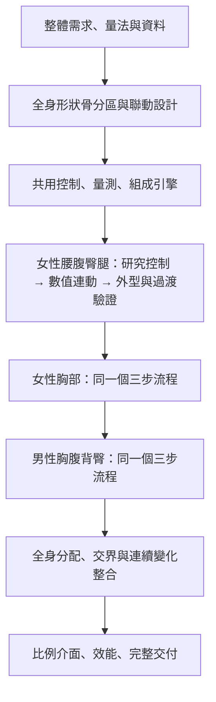

# BodyRef 本輪完整交付計畫：形狀控制、實際數據與整體造型

日期：2026-10-21。本版整合後續胸型、肌肉、腰腹臀腿參考與霧面輸出的討論。狀態：計畫總整，尚未恢復模型實作。

**本文件取代 `09e0694`、`7cef823` 的交付範圍與開工引導，以此版為單一施工規格。** 兩次失敗保留在 [HISTORY](HISTORY.md) 作為設計約束。內部研究、總表、分區原型都是施工成果；作者下一輪要驗收的是所有本輪功能整合完成的可用版本，不是逐步簽核總表或局部原型。

產品定位：**體模偏向美術，控制偏向實際數據。** 解剖、掃描與真人參考用來研究表面形變的依據；不用即時建立獨立肌肉塊、脂肪塊或器官再求外皮。保留原版有效造型與可用資產，重建不足的控制能力、數值驅動和交界關係。

## 1. 要完成的系統與工作範圍

建立一套能以實際尺寸控制人體、又能因肌脂和骨性條件改變形態的形狀骨系統。它須保留美術向的誇張比例，處理部位之間的共同變化，並維持尺寸與重量的一致性。

本輪範圍是：

1. 全身控制分區、層級、相鄰區域連動及數值驅動的共同設計。
2. 女性腰腹、後腰、臀後／臀側／臀下與大腿根的完整控制。
3. 女性三種可切換胸型：水滴（預設）、長水滴／木瓜、圓潤；共用形狀自由度、尺寸與組成引擎。改善上胸圍的內部量測／轉換，包含一般及小胸廓 E 和既有大胸案例。
4. 男性胸廓、胸肌、胸脂、腹背、臀部與大腿根的控制。
5. 可獨立操作的肌肉量輸入、體脂、其他去脂成分、未填尺寸與全身重量分配；固定圍度區仍參與形態和組成更新。
6. 上臂、腰、肩等來源量法對齊，改善未填部位分配。
7. 既有比例介面改為 `1 : 比值`，保持長度與分享碼的意義。
8. 中性霧面預設顯示、清楚的光照及乾淨的參考圖輸出，保留量測／結構疊線的獨立開關。
9. 全身外型、數值、連續變化、操作、分享相容、效能及同版本證據。

獨立骨盆寬輸入、真正臂展、InBody 分段輸入、命名臀型選單、胸型自由滑桿／更多胸型、胸罩與服裝、超出現有範圍的 ZZ、精細肌肉刻線／血管、GLB／OBJ、深度／法線／骨架圖、新姿勢及皮膚，仍是後續功能。肌肉的主要體量與表面形態、臀型所需的底層自由度及自然連動，本輪必須完成，不能以上述延期項目為理由省略。使用者自備模型仍屬構想未定。

胸型選單已有三種明確約定；臀型只約定控制能力與造型方向，未約定命名選單數量，本輪不自行增加。沒有需要作者再選擇才能開工的產品方向；控制數量、權重、內部量法與校準參數由實作者研究、製作及驗證，不把選係數或逐項看原型的工作交回作者。

全身規劃包含每個區域的責任與交界，不表示每個部位都要換掉已有效的控制。原網格、有效截面曲線及既有形態是可用材料與比較基準；是否保留某個控制，由它能否符合整體設計決定。

## 2. 先區分三種順序

### 2.1 大部：整個專案的施工順序

**需求與量測定義 → 全身解剖分區及聯動設計 → 共用控制引擎 → 分區完整實作 → 全身整合校準 → 介面與整輪交付。**

先決定整體控制關係與各區責任，才開始局部施工。脂肪、去脂、重量與統計偏好的規則在總設計時定義；共用數值引擎在第一個區域實作時就接入，不延至男性階段才補。

### 2.2 細部：每個區域的三步

**① 研究並實際完成分區、形狀骨、權重與連動 → ② 完成實際尺寸及組成數值到形變的映射 → ③ 驗證外型與連接過渡，修到成立。**

各階段由實作者自行檢查、修正並繼續，階段完成不代表停下來等作者驗收。最終一次交付全輪；只有新的產品取捨或與既定需求無法同時成立的具體矛盾才需要討論，例行工程決策自行完成。

第三步根據實際輸入與鎖定條件檢查。若不合理，定位問題後回修第一步的控制能力或第二步的驅動規則；不能在最終表面另外疊一塊補丁而不回到控制設計。

第一步可以檢查權重、單控制效果、局部穿插和明顯折面，這是控制除錯；不代表實際數值驅動後的外型已合格。

### 2.3 執行期：使用者調數字時的計算關係

上述是施工順序。運作時形態和尺寸共用同一個表面，需相互校正，不是先產生外型、最後再強行縮放至目標。

`表面 S = F（骨性框架 b，形態條件 c，區域控制 u）`

`使用者尺寸 M(S) = 指定值`，並同時核對指定重量、組成及區域形態的有效範圍。

`c` 會改變形狀骨的位置關係、增減方向、作用範圍與表面輪廓；`u` 在這個條件下找到滿足量測的控制量。這是作者所說的雙控制。

## 3. 階段 A：需求、量測、資料與基準

### 3.1 先定義控制輸入的意義

| 類別 | 本輪處理方式 |
| --- | --- |
| 骨性框架 | 身高、四肢長度／比例、肩與胸廓等參照；脂肪增厚不直接當成骨盆骨頭變寬 |
| 圍度與長度 | 使用者明確指定的是最終表面的硬條件，固定圍度不固定整區頂點 |
| 體重、體脂 | 明確輸入時是總量／組成條件；未填時有來源標記的估計與輸出，不回饋成新的實測證據 |
| 肌肉量 | 本輪新增獨立可操作輸入，驅動全身肌肉體量與形態；明確定義為骨骼肌估計量，去脂量不能全部改名肌肉量 |
| 未填尺寸 | 依資料與預設分配作軟偏好，不能取代手動值或禁止誇張比例 |
| 姿勢 | 使用同一份中性形態結果再變換；不把擺姿勢誤算成增減組織 |

建立「輸入 → 可影響控制 → 必須保持的條件」表。尤其寫清楚：只改罩杯而體重未鎖時，新增胸部體積可以改變輸出重量，但不能因此啟動全身肌肉造型；鎖體重時才處理必要的跨區補償。

### 3.2 建立使用者與資料來源的量測定義

- 使用者腰圍仍是最細腰；資料中的肚臍腰、髂嵴腰各自建立對應路徑，不拿固定公分換算混用。
- 使用者肩寬仍採經後頸的服裝量法；骨點直線是另一項資料來源量測。
- 上臂區分屈臂二頭肌與放鬆中段圍；核對來源中點及目前網格約 55% 的位置差異。
- 下胸釐清胸壁、乳房根部、自由表面及皮尺路徑；不能用刪掉全部乳房形變支撐區的方式替代。
- 上胸圍按第 6.3 節完成內部量法、穩定量測與自然站姿形態的對應；不新增要求使用者理解換算的量測模式。
- 臀圍確認量測區間及皮尺定義，保留實際截面位置；新舊量法差異與造型差異分開記錄。
- 所有硬條件在最終中性曲面量測；會改輪廓的平滑也必須納入。若要改使用者可見的量法，需明確處理舊分享碼，不能默默換意義。

### 3.3 資料分工

| 資料 | 用途 | 不應推導的東西 |
| --- | --- | --- |
| 解剖及表面形態研究 | 分區、骨性支撐、附著、肌腹與脂肪分布、交界原則 | 通用的「每公斤移動幾公分」係數 |
| MakeHuman CC0 網格與目標 | 拓撲、骨架與形態研究材料，可用的控制／曲面起點 | 未經檢查的人體掃描真值 |
| ANSUR 尺寸資料 | 符合來源量法的尺寸關係與變異 | 由人工生成的體脂、下胸還原實測表面 |
| NHANES 身體量測／DXA | 放鬆上臂、實測體脂與粗分區分配的校準 | 把 DXA 去脂軟組織當成直接測得的骨骼肌，或直接得到表面頂點 |
| Seamscape 公開外觀 | 多視角觀察部位協同及連接過渡，記錄取捨 | 複製模型、資料、係數或當作唯一正確外型 |
| ABMX 公開原始碼／文件 | 多控制、父子參照、局部變換及一對多／多對一控制的架構參考 | 直接推定 HS2 精確權重、解剖規則或公分／公斤換算 |
| 作者提供的創作與照片 | 喜好的比例、表面關係、自然連接與不接受的邊界 | 反推個人體脂、重量、醫療經歷，或把姿勢、衣物壓迫與反光當中立幾何 |

來源已找到不等於研究和校準已完成。A 階段完成來源、量法及資料處理規格，B 階段產出可用於控制設計的研究結論；需要擬合的數值模型於 D 階段接數值前完成對應部分。

### 3.4 建立基準

以 `f4e2aff` 的應用程式及較好的既有輪廓作比較；規劃時 main `7615057` 與其應用程式相同。新實作從最新乾淨 main 開始，確認其後合法更新。

記錄固定案例的輸入、量測位置、正側後斜視、局部截面、總量、冷算與重算速度。原版的缺陷也標記，不以「完全一樣」當作改好。

**A 完成條件：** 可核對的需求／量法表、資料來源表、固定案例與版本基準；沒有把推估欄位當實測。此時不調新形變公式。

## 4. 階段 B：全身形狀骨分區與連動總設計

### 4.1 先研究哪些事

研究目標是把人體表面變化轉成控制能力。每個部位要回答：什麼位置由骨架支撐；肌腹在哪裡飽滿；脂肪覆蓋可如何改變；哪些邊界限制滑移；增減時應帶動哪個鄰區。

每項結論記錄「來源觀察 → 控制需求 → 檢查方式」。具體位移幅度是待校準的工程／造型參數，不能把取名為臀肌、胸肌的凸起稱為解剖驗證。

### 4.2 全身控制層級

| 層級 | 責任 | 與其他層的關係 |
| --- | --- | --- |
| 骨性參照 | 胸廓、骨盆、脊柱、關節及長度比例，提供局部座標 | 改框架時帶動周圍控制；軟組織變化不任意改骨架 |
| 區域形狀骨 | 截面前後側形狀、肌腹厚度／寬度、覆蓋及飽滿位置 | 接受形態條件及尺度控制，可分區且可聯動 |
| 交界控制 | 胸腹、腰臀、側臀腿根、臀下腿後、胸根胸壁等共同過渡 | 相鄰區共享邊界與變形規則，不能各推一遍再抹平 |
| 必要修正形變 | 處理已定位、常規控制難以表達的局部或組合變化 | 在實際數值驗證後校準，納入相同表面與量測，不作顯示遮掩 |

現有「形狀骨」主要是截面圈、方向縮放和位移場。本方案選擇將它們組成有區域層級與局部控制的系統；不要求所有控制都必須是一根可旋轉的實體骨，也不即時計算肌肉束／脂肪小葉。

### 4.3 全身分區與交界責任

| 控制群 | 必須表達的能力 | 必須共同處理的交界 |
| --- | --- | --- |
| 胸廓、肩、上背 | 框架寬深、肩部連接、胸背尺度的不同響應 | 頸肩、腋側、胸腹；不能讓上背任意吸收胸圍誤差 |
| 女性胸部 | 根部、上極、下極、內外側、胸峰與覆蓋 | 胸壁、上胸、腋側、中央及乳下過渡 |
| 男性胸部 | 胸廓、胸肌分布、前胸／外下側脂肪覆蓋 | 胸骨、鎖骨、腋側、胸腹；不用女性杯型作主模式 |
| 腰腹、後腰 | 前後側截面、下腹飽滿、腰窩與覆蓋 | 下胸、骨盆、臀上；不靠挖低中線兩側製造脊稜 |
| 骨盆周邊、臀部 | 臀上、臀後、臀側、臀下的方向與分布 | 骶尾、後腰、側臀、大腿外側及後側 |
| 大腿、腿根 | 前後內外輪廓、肌腹／覆蓋、向膝過渡 | 左右腿根各自局部座標，連接臀側與臀下；避免同一圓柱包住兩腿 |
| 上臂、前臂 | 脂肪與肌腹的不同增減、近關節收束 | 肩腋、肘、腕；不整條等比加粗，不固定承擔新增去脂的 18% |
| 小腿、踝及頸等 | 保留既有有效形態，核對組成與尺度響應 | 膝、踝、頸肩；不成為未驗證的重量補償出口 |

這張表定義全身責任。實作可保留符合規格的既有部位控制，新增自由度集中在目前缺少的能力。

### 4.4 每個形狀骨／控制的規格

每個控制記錄：名稱與用途、父參照、局部座標、可動方向、作用頂點與權重、附著區、肌脂條件下的模式、允許範圍、鄰區聯動、預期量測及體積響應。

控制數量依所需獨立能力決定。例如側寬與後翹無法分別表達時，才增加相應控制；需要一起移動的多個分區則建立聯動。不預先以 84 點或更多點當作正確架構。

連接過渡在這一階段就要設計，到了數值驅動後的第三步驗證它；不能等出現折痕才第一次思考交界屬於誰。

### 4.5 在總設計時定下數值與重量的責任

- 手動尺寸限制最後量測，不直接等同形狀骨倍率。
- 肌脂條件改變模式及尺寸響應，形態改變後重新量測；固定圍度區仍能改形和重算組成。
- 指定體重與體脂時，脂肪與去脂總量各有帳；同一過渡區不重複計量。
- 統計軟偏好、區域分配與有效形態範圍共同決定自由量去向，不能只看哪裡公分差最大。
- 原生胖瘦目標已增加的量體要進帳，局部增量不能再加一次同樣的公斤數。
- 尺寸只可驅動負責區域和必要相鄰區，不能用任意全身參數湊任意目標。

**B 完成條件：** 全身分區圖、控制與聯動規格、交界責任表、資料到控制的依據、數值驅動設計。尚未得到的參數有明確校準方法和案例，不能空寫「稍後調到自然」。

## 5. 階段 C：共用控制與驗證引擎

依 B 的總設計建立最小可用引擎，讓所有區域使用同一套控制、量測、組成與驗證機制。不是在這裡一次啟用所有新造型。

### 必要能力

1. 區域控制及交界登錄；能顯示參照、權重和受影響範圍。
2. 形態條件可改變控制模式及支撐範圍；不只把同一位移場乘不同倍率。
3. 使用者與來源量法分開，能顯示皮尺路徑及截面。
4. 小範圍數值求解、總量記帳與分配介面；第一個區域接數值時即可使用。
5. 單控制、聯動控制與實際輸入三種除錯入口，能隔離控制、映射、分配與顯示差異。
6. 確定的初值、版本化資產與快取鍵；同一輸入不受操作歷史影響。

原網格拓撲與有效的方向性截面／PCHIP 可以沿用；新系統的共同介面要先成立。暫未重做的部位透過明確介面使用舊控制，不讓新舊兩套控制同時對同一區域重複增厚。

離線準備拓撲標記和權重，執行期只更新必要控制。建立引擎時不把身體各區預先雕成幾個「已接受體型」作為其餘數值都必須追上的目標。

**C 完成條件：** 可獨立操作與檢查的控制引擎；未啟用新區域時可重現基準；能量測控制的響應；組成和數值介面已可用。這是工程驗證，不是自然外型的驗收。

## 6. 階段 D：按優先順序完成各區域的三步

### 6.1 每個區域一致的施工流程

| 步驟 | 具體工作 | 產物與判定 |
| --- | --- | --- |
| ① 研究、建立控制 | 細化 B 的該區研究；建立局部座標、分區、形狀骨、權重與交界聯動；調試增加與減少 | 可以操作的控制與聯動示範；知道每個動作改哪裡、影響誰 |
| ② 接數值 | 接上實際圍度、形態條件、區域量體及總量限制；量測響應、校準映射、對準硬條件 | 真正輸入公分、公斤、體脂後的模型；數值與帳可查 |
| ③ 看外型與過渡 | 在實際輸入、鎖定條件、連續掃描下檢查正側後斜視與截面；確認輪廓與相鄰區 | 同一版本的外型、過渡、尺寸結果；不合理就回到①或②定位修正 |

第三步產生的合格代表狀態可以保存成回歸基準；必要的校正形變也在這裡建立。它們記錄並補足控制的結果，不能取代第一步的分區／連動研究。

### 6.2 區域順序

**D1：女性腰腹—後腰—骨盆周邊—臀—大腿根。**

作為第一個完整驗證架構的區域。把腰側、腹前、下腹、後腰、臀上／後／側／下、腿根外側與後側作為連續控制群，不先獨立修臀後，再補其他面向。

實際增臀圍時同時檢查側寬、後投影和上下作用範圍；固定大腿圍只限制量測，不凍結腿根。肌腹和脂肪覆蓋採不同連動，保持骨盆寬與假胯寬的區分。重點拒絕方腿、球塊、臀下台階與突出脊稜。

本輪造型要求：

- 腹部預設為腰側適度收束、上腹平順、腹前有柔和起伏、下腹適度飽滿並接入骨盆與腿根。豐滿胸臀腿可以與收束腰腹並存；不把更大腹部當唯一豐滿模板，也不強迫所有體脂／尺寸維持細腰。
- 增加腹部體量時，同時調整前凸、側向展開、轉折深淺與位置。避免只有輪廓加寬，中央仍保留瘦體型的深窄分界；也避免中央鼓包、兩側另貼幾塊的效果。
- 臀後投影、側向展寬、飽滿位置、上下分布及過渡長度須有可區分的控制能力。臀圍是共同結果，不等於一個後方圓頂的高度。
- 後腰到上臀、側臀到外側腿根、臀下到大腿後側採不同連動。自然臀下褶可以保留，不能把所有轉折磨平，也不能切成固定水平台階。
- 大腿前後內外側分別有形態，體量沿長度分布並向膝部收束；避免方腿、均勻圓柱、根部突然收成尖錐。固定大腿圍時仍調整連接，不偷偷放寬該圈尺寸。
- 小幅凹陷、平面、皺褶並非一律錯誤。以姿勢、相鄰體量和多角度表面能否一致解釋作判斷；不以「夠圓滑」當自然性標準。

**D2：女性胸廓—根部—乳房表面。**

同樣完整走三步。根部隨胸廓，杯量與肌脂條件帶動上極、下極、內外側及胸峰；小胸不能靠把大胸削平取得。先測一般 B／E、小胸廓 E，再涵蓋現有 G／S 及大胸案例，整個區域完成後才算交付。

根部標記不能只取最大骨權重，也不能將全部杯型目標涉及的頂點排除出下胸。三種胸型及切換本輪全部完成，細則見第 6.3 節。

**D3：男性胸廓／胸肌／胸脂—腹背—臀腿。**

先後細化男性胸部與腹背臀腿控制，分別走三步並保留共同交界。胸肌有自己的肌腹分布，脂肪有自己的覆蓋模式；不採女性乳房圓頂作主模式。檢查胸骨、鎖骨、腋側、胸腹與下背的接續。

肌肉型與脂肪型是可共存的連續條件，不是非此即彼的兩個開關。固定胸圍仍能表現不同組成的形態；本輪不另建男性女乳症專用模組。男性臀部也必須有自身分布與過渡，不能只沿用女性參數再縮小。

**D4：其餘區域響應與分配適配。**

對上臂、大腿、小腿及其他自由區檢查現有控制是否符合共同模式、量測及重量介面。可用的保留；原本的固定去脂比例、整段等比膨脹或錯誤量法要修正。需要變更新控制的區域仍走三步，不能當全身補償黑箱。

這個順序保留女性腰腹臀的最高優先，同時涵蓋原本另一個 AI 提出的上臂與自由分配問題。D4 不代表全面重雕四肢，而是讓每個參與分配的區域都有明確、可驗證的責任。

### 6.3 女性胸型與內部胸圍處理

**共同自由度與三種預設。** 底座寬深、上／下部飽滿分布、內外側展開、朝向、挺立／垂墜與胸距由共同控制系統表達。水滴（預設）、長水滴／木瓜、圓潤是同一組自由度的規則組合，可隨胸廓、大小和組成調整，不是三份互不相干的模型。

- 不以罩杯字母決定必須使用哪一型；不強制 E 變木瓜或小胸都削成平片。同罩杯不同下胸圍的體量差異也須處理。
- 切換胸型保持明確鎖定的尺寸及組成條件，改變分布與表面形態。非手動體重可反映體量變化，不能因此反向啟動無關全身肌肉變化。
- 新增胸型應能加入新的控制組合、適用範圍與驗證案例；數值引擎共用。未來開放自由滑桿或加入胸罩支撐層，不需重建整套胸圍引擎。本輪不做衣物物理。

**量測改進的目的。** 解決單一乳頭高度切面與局部胸峰補量造成的扁片、尖錐、量測位置跳動及大胸失真。量測點隨形態移動不一定是錯；不能靠固定切面高度就聲稱修好。

- 保持站立顯示；使用者不需要看模型彎腰、選換算模式或學習換算公式。
- 「女性上胸圍一律彎腰量」不是已成立的統一標準。研究不同量測規程時明確區分站立、前傾與臥姿，不將它們混成一個已驗證數據。
- 實作者先核對現行上／下胸輸入與罩杯的意義，完成有效量測路徑、必要的等效量測／轉換及自然站姿表面的對應，再用三種胸型和大小序列校準。前傾量測可作研究方法，並非已選定必用的轉換公式。
- 如果採等效量測，必須同時保留內部目標、獨立量測結果和站姿幾何指標，不能直接回傳輸入值或沿用舊切面讀值冒充達標。校準與驗證分開；轉換公式、假設和誤差記入技術文件，不塞進一般使用流程。
- 下胸皮尺須對應胸壁及根部關係，不穿過自由乳房來抵銷誤差。形變、量測和顯示必須對同一份有效表面負責。
- 若量測語意需要版本變更，完成舊分享碼遷移與相容說明；不默默改數值意義。任何前傾對應未經資料驗證前，不宣稱可精確預測真人量測。

此處是實作責任，不是留下給作者指定公式的未決問題。不能把一般 E 案例的控制失敗推給使用者輸入，也不能把所有歷史胸型問題都歸因於乳頭切面。

## 7. 數值連動如何實作

本節是 B 階段要定義、C 建立共用機制、D 第二步逐區接入的規則。不是 D 做完才開始設計。

### 7.1 同一表面上的受限求解

1. 依明確輸入建立骨架、形態條件及確定的分配初值，保留手動／估計／輸出來源。
2. 使用當前形態條件下的控制模式生成曲面，量測真正皮尺、體積與區域輪廓。
3. 只調目標區域及必要交界的有限控制，逐步對準尺寸；多個互相影響的控制作小型局部聯立校正。
4. 總量不足或超出時，提出有區域責任的分配候選，包含固定圍度區域的形態自由度；候選重新核對所有受影響硬條件。
5. 尺寸與總量有效、形態在已檢查範圍內，且軟偏好改善才接受。形態條件改變時更新相關響應，不沿用過期校準，也不重算全部無關區域。
6. 最後重新搜尋量測位置、核對最終中性曲面及總帳，再產生姿勢與顯示。

不能靠擴大負值、整圈壓縮或局部削洞，讓不合格形態成為可行解。一般 E 等已列為本輪必支援的案例失敗時，先定位控制能力、量法或映射，不宣稱生理不可能。

### 7.2 體脂、去脂與肌肉形態

固定腰 68、體脂從 18% 改成 35% 時，腹前、腰側、下腹及後腰的形態可改變；同一套控制維持皮尺仍為 68，並重算該區量體。這個能力必須在 D1 第二、三步就展示。

指定體重與體脂給出脂肪／去脂總量；去脂還含骨、器官、水分等，不能全部分配為肌肉。肌肉形態需要存在且可測，但估計來源要清楚；不能把改臀造成的推估體重重新當成實測肌肉量。

本輪完成獨立肌肉量 UI、手動／推算狀態與分享保存。工程預設採骨骼肌估計量 kg 作主值，百分比若顯示則由體重換算；同一數量不設互相矛盾的雙重硬輸入。這是模型的組成輸入，不宣稱由圍度即可唯一量出真人骨骼肌量。

總帳至少區分脂肪、骨骼肌與其餘去脂成分；後者有合理的模型基準和範圍，不得任意改密度或成分比例來吃掉重量誤差。固定體重／體脂時，肌肉輸入的可用範圍受剩餘成分約束；不允許負組織量，不默改其他鎖定值。對實際互斥輸入明確指出衝突條件；控制或收斂失敗須另行診斷，不能稱為生理不可能。

肌肉改變要在胸肩、上臂、腹背、臀腿等主要區域有可見且連貫的體量／形態響應；不是只換內部百分比，也不是必須刻出腹肌或血管。固定尺寸的配對案例仍需看得出肌脂形態差異。

### 7.3 資料校準的執行工作

- 取得同調查期的 NHANES 人口、身體量測、DXA 公開資料，以受試者鍵連接，處理成人範圍、品質旗標、有效樣本與調查權重。
- 擬合放鬆中段上臂的條件偏好，並校準粗分區脂肪／去脂分配；採留出驗證，記錄誤差與涵蓋範圍。
- 核對 DXA 分區與網格區域，不把整臂重量直接當上臂局部重量，不把去脂軟組織當骨骼肌。
- ANSUR 與 NHANES 使用各自量法和條件模型，不能把不同受試者資料拼成一筆，或憑空產生跨資料集共變異。
- 統計偏好仍可讓步；不把資料平均值變成美術造型限制，也不強制所有未填圍度落在 ±2～3 cm。
- 明確標示現有人工推估體脂、下胸的用途。優先替換有可靠資料支持的偏好；沒有實測支持的欄位不改稱已校準。

資料處理規格在 A／B 確定，相應數值模型在區域接入前完成，E 再檢查其全身效果；不是最後才發現量法不一致。

## 8. 階段 E：全身聯動與分配整合驗證

各區已完成三步後，驗證共同工作，而非此時才建立重量系統。

1. 固定胸腰臀再增加體重；再加入固定大腿，觀察固定區形態和自由區尺寸如何共同承擔。
2. 同尺寸、不同體脂／肌腹模式，確認形態差異與總量同時成立。
3. 改罩杯、臀圍、肩寬、身高及比例，檢查必要連動和不相關部位是否意外被驅動。
4. 檢查胸腹、腰臀、臀腿、肩臂等跨模組交界；局部合格不代表組合自動合格。
5. 比較 T2／T3／T4 的上臂和臀腿，避免修正一端後另一端失衡。
6. 連續掃描中間數值、反覆鎖定／解除，檢查模式切換和量測位置跳動。

全身分配成本包含未填尺寸的標準化偏差、區域分配偏差和偏離有效形態的程度。固定圍度區的形態自由度不能排除；也不能把體重誤差全轉到上臂、臀腿或未量測的上背。

若整合失敗，指出是哪個交界、映射或控制能力不足，回修對應模組並重測其影響範圍。避免在整合層新增無來源的全身補償位移。

## 9. 階段 F：比例介面、效能與完整交付

### 9.1 比例介面

- `身高 : 股下 = 1 : 0.48`，右側增加表示腿更長。
- `身高 : 手臂長 = 1 : 0.35`，手臂長仍是肩點到手腕，右側增加表示手臂更長。
- 分段比例明寫方向，如 `大腿 : 小腿 = 1 : r`；內部若存相反方向，在 UI 正確換算，不默默改舊值。
- 比例／直接長度互斥、鎖定／解除、儲存與分享必須相容；改顯示方式不能改變相同內部值的模型。
- 真正臂展需水平展臂的指尖距離，留待後續，不用服裝肩寬加兩條手臂冒充。

比例意義在 A 已定，介面實作可以獨立安排；必須在本輪結案前交付，不能再次遺漏。

### 9.2 效能

同設備比較基準和候選的冷算、經過另一輸入後的重算、p95；完全相同輸入的快取另記。以中位數及 p95 不超過基準 1.2 倍作為本方案初始工程預算，保留既有測試 timeout；這是工程選擇，不是人體資料。

權重、拓撲綁定等離線或載入時準備；執行期求少量相關控制。先處理重複重建與多餘量測，不用拉長 timeout 掩蓋互動退步。必要的品質／效能取捨應附量測和具體選項，不能自行宣稱完成。

### 9.3 結案條件

需求表每項都能對應到實作、案例與同版本證據；D1–D4、全身整合、三種胸型切換、肌肉輸入、比例介面、霧面輸出與分享相容全部完成。外觀、數值、效能、操作、授權及文件各自通過，再依現有 PR／發布流程交付。

不以原型完成、測試全綠或來源找到單獨宣布整輪完成。預覽清楚標版本，使用實際可用的網頁方式；不再承諾未驗證的對話內互動 artifact。

### 9.4 中性霧面與 AI 參考圖

- 全模型以中性灰色霧面為預設，柔和方向主光加適量補光、與模型有明度差的簡單背景；保留體量讀取所需的陰影，降低強高光及過度凹處壓暗。
- 日常預覽與圖片輸出使用同一個合格表面，不以特殊光線遮掩壞形。驗收另換光向、關閉強化凹陷／結構線等，區分幾何、法線與材質問題。
- 保留目前視角截圖與同尺度正交三視圖，提供不帶量測表／數字／線條的乾淨輸出；正、側、背、斜側視角可供參考。附量測的版本仍可選。
- 這一輪交付可用的霧面參考圖；深度、法線、獨立輪廓遮罩、骨架圖及 3D 格式依後續 AI 流程再增加，不預設某一格式對所有 AI 最好。

## 10. 驗收案例與方法

### 10.1 重點案例

| 組別 | 固定輸入或定義 | 核心驗證 |
| --- | --- | --- |
| H 系列 | 女，身高 165，上胸 97，下胸 76，腰 68；臀 94／104／114／124／130；體重不鎖 | 正面假胯寬、臀後、臀下與腿根的共同變化 |
| H 固定大腿 | 從基準 H104 取一次大腿圍寫成 fixture，固定該值掃描臀圍 | 固定大腿圍仍能改善腿根連接，不重算 fixture 偷改目標 |
| 16 組 E | 女，身高 160；上胸 85／90／95／100，下胸＝上胸−20；腰 56／64，臀 104／114 | 一般及小胸廓 E 的可達性與完整胸型 |
| 女性組成 | 身高 165，體重 60，上胸 94，下胸 74，腰 68，臀 104，大腿 56；體脂 18%／35% | 同尺寸的表面差異、固定部位重新記帳 |
| 男性組成 | 身高 175，體重 80，上胸 105，腰 85，臀 100；體脂 18%／35% | 胸肌／脂肪與腹背臀形態不同，尺寸仍守住 |
| 固定多部位增重 | 女，身高 165，上胸 94，下胸 74，腰 68，臀 104；體重 60／75／90 及中間值；另加固定大腿 56 的配對 | 全身分配與局部形態容量，不出現單區異常膨脹 |
| T4 | 女，身高 158，體重 80 | 腰、上臂、臀腿的分配 |
| T5-105／125 | 女，身高 160，下胸 70，上胸 105／125 | 大胸根部、上胸、下極與肩胸交界 |
| T6 | 男，身高 170，體重 97 | 偏胖男性胸部、腹背與臀腿 |

既有 T1–T7、W45–W90、BF15–35、手動上臂、罩杯及操作順序案例完整保留。具體支持範圍以現有功能和上述需求為準，不為讓測試過而刪案例。

新增案例：三種胸型分別涵蓋小胸、一般 B–F、小胸廓 E、G 與既有大胸範圍；切換時檢查鎖定值與連續大小變化。獨立肌肉量在男女各有自由尺寸與固定尺寸配對，檢查形態、總帳、鎖定衝突及分享回復。霧面輸出檢查同尺度、多角度、疊線開關與預覽一致。

超約束的增重案例用來測試分配容量與衝突處理，不宣稱任意重量都能放進任意固定尺寸。必須區分有效解、經診斷的輸入衝突與演算法未收斂；不因失敗就刪除案例，也不為湊數造出尖錐。

### 10.2 外型與過渡

每個區域第三步以及 E 的整合都要看：同尺度、同姿勢、同光照的正側後與前後斜視，關閉量測／結構疊線，補局部放大和多高度截面。輪廓與表面陰影都檢查。

阻擋交付的既知表現包括：正面腰臀側線退步、方腿、臀下台階／球塊、後腰脊稜、女性胸部扁片／長袋／肩胸溝、男性女性化杯型，以及自由區尖錐或異常膨脹。

新增腹部檢查：外輪廓已豐滿但內部仍留深窄瘦體型溝線、中央腹凸與腰側各自成塊、無姿勢或接觸理由的層層凸緣。正常凹陷與臀下褶不因「看見界線」就全部抹除；需檢查其位置、深淺、範圍和周圍體量。

寬深分布、飽滿位置、截面、邊界切線與曲率可協助定位，但單一比值或無尖角不等於自然。第三步的外型判斷要有逐項觀察，不能只記「截圖成功」。

Seamscape 用於多視角連接參考，逐區說明採納的概念與未採用之處；不以它的形狀覆蓋本專案判斷，不作逐頂點／輪廓數值擬合。比較資料留在倉庫外。

### 10.3 數字、版本與失敗診斷

- 手動圍度／長度誤差不超過 0.5 cm、體重 0.5 kg、明確指定體脂 1 個百分點；不因改形放寬。新增肌肉量的內部組成帳誤差以 0.5 kg 為工程上限，不等同真人測量精度。胸圍若採轉換，分開報告指定量法誤差、轉換驗證誤差及站姿幾何，不混稱直接切面達標。
- 核對總帳、重疊區不重複計量、最終曲面體積、量測路徑、非有限座標、翻面與新增穿插。
- 同輸入不依賴操作歷史，測試鎖定／解除、比例／長度、分享、快取及姿勢。
- 圖片與數值報告固定同一 commit／工作樹摘要、資產、量法、案例及渲染版本；產出期間不繼續編輯該快照。
- 出現故障時保存「單控制 → 聯動 → 數值驅動 → 分配／顯示」的隔離結果，判斷是哪一層造成。這是診斷順序，不是先驗收無數值的漂亮外型。

## 11. 從兩次失敗轉成工程限制

| 過去做法／故障 | 本方案的限制 |
| --- | --- |
| 解剖名稱直接當凸起公式依據 | B 必交研究到控制的映射，D 的實際數值結果再驗證 |
| 先做漂亮關鍵形態，再設法湊尺寸 | 控制研究先行，接數值後才正式驗收；關鍵狀態作校準／回歸結果 |
| 平滑控制網、更多點等同自然 | 以獨立形變能力決定分區，檢查真實輸入下的連動與過渡 |
| 原版較好的輪廓被替換掉 | 同輸入保留原版對照，區分原有缺陷與新增退步 |
| 多個位移場在交界各做各的 | B 指定交界責任，C 統一合成，D 第三步驗證 |
| 女胸削平、男胸乳房化 | 男女不同控制配置，限制可用模式；修能力而非擴大破壞性負值 |
| 輪廓加肉、內部轉折未同步 | 同時檢查表面分布、腰側界線、腹前到胯部的過渡及不同光向 |
| 胸圍目標直接等同乳頭圓頂 | 胸型自由度與量測約束分工，獨立校準量測和站姿表面 |
| 固定圍度區不參與組成更新 | 在共同介面中保留其形態自由度與記帳責任 |
| 推估重量反推全身肌肉 | 輸入來源與依賴明確，輸出不自行升格成實測條件 |
| 全身分配太晚才加入 | B 設計、C 建介面、D 就接入，E 做完整整合 |
| 數字通過取代外型通過 | 每區第三步與 E 都有實際外型證據；已知退步阻擋交付 |
| 測試期間仍修改程式、挪用舊報告 | 固定版本，失敗如實保留，不跨快照宣稱成功 |

## 12. 分工到程式與可交付產物

本節是實作責任，不是聲稱模組已完成；檔名可依清楚的責任分離調整。

| 責任 | 入口及產物 |
| --- | --- |
| 全身設計 | 控制分區圖、聯動表、來源到控制對照、量法與輸入依賴表 |
| 資產／控制準備 | `tools/prepare_body.py` 周邊的自有標記與權重流程；核對 CC0 資產與新增來源授權 |
| 控制生成 | `src/body/mh/rings.ts` 及區域模組，統一座標、模式、交界和表面合成 |
| 數值與分配 | `src/body/mh/distribution.ts`、goals／linkage，統一硬條件、軟偏好與組成帳 |
| 量測 | `src/body/mh/measure.ts`，使用者與來源量法、實際路徑與版本 |
| 資料校準 | 統計處理工具、有效樣本／誤差紀錄、可重現的衍生統計 |
| 顯示 | 中性曲面與姿勢、平滑的明確順序，不使用未計量的顯示補丁 |
| 比例介面 | `src/core/proportions.ts`、UI、狀態相容與相關操作測試 |
| 胸型／肌肉操作 | 三種胸型、獨立肌肉輸入、鎖定規則、儲存／分享及舊碼遷移 |
| 參考圖輸出 | 中性霧面、光照、乾淨單視圖／三視圖、可選量測資訊 |
| 驗證 | 有效的自有案例、圖像產出與數值工具；暫存原型、截圖及外站資料留在倉庫外 |
| 交接 | 本計畫、HANDOFF、HISTORY 與來源記錄，分清已完成、待校準和後續 |

每個區域的交付包含三份連續證據：控制設計／示範、數值驅動結果、外型與交界判讀。整輪另交全身分配、操作及效能結果。只有控制圖或只有漂亮截圖都不完整。

## 13. 研究入口與資料狀態

- [臀部皮下結構](https://pubmed.ncbi.nlm.nih.gov/36519643/)：用於研究區域覆蓋、支撐與附著。
- [臀下褶 MRI／解剖](https://pubmed.ncbi.nlm.nih.gov/33462737/)：用於臀下與腿後交界設計，不把臀褶當固定水平切口。
- [乳下褶筋膜結構](https://pubmed.ncbi.nlm.nih.gov/34998682/)：用於根部、下極與過渡關係。
- [胸大肌三維結構](https://pubmed.ncbi.nlm.nih.gov/19291757/)：用於胸肌分區及附著，不直接提供表面增長公式。
- [腹部皮下組織](https://pubmed.ncbi.nlm.nih.gov/8838275/)：用於腹部覆蓋與結構分層研究。
- [NHANES 身體量測](https://wwwn.cdc.gov/Nchs/Data/Nhanes/Public/2017/DataFiles/BMX_J.htm) 與 [DXA](https://wwwn.cdc.gov/Nchs/Data/Nhanes/Public/2017/DataFiles/DXX_J.htm)：已確認公開來源，尚未完成下載、擬合與專案校準；需核對對應調查期手冊、品質和權重。
- [Seamscape BodyDouble](https://seamscape.com/bodydbl)：外觀參考；不複製其內容或作唯一標準。
- [ABMX 原始碼](https://github.com/ManlyMarco/KKABMX/tree/c7598cdcec6e60b320f8c6c3ec794849232a61b7)：已核對局部變換、多骨效果及 AI/HS2 控制清單；不能僅憑名稱推定權重與精確骨鏈。只借鑑架構，不複製遊戲資產或係數。
- [作者提供的 Patreon 公開說明](https://www.patreon.com/posts/85774262)：已核對是角色模組使用與 ABMX 需求說明，並非胸型／胸圍公式教程。
- [Unity 蒙皮說明](https://docs.unity3d.com/6000.0/Documentation/Manual/class-SkinnedMeshRenderer.html)：控制節點需配合網格、綁定與權重；節點數量不等於造型品質。

作者的照片、創作、裁切、縮圖以及外站比較材料一律不進倉庫。持久文件只保留抽象造型要求、合法來源連結與研究結論；不從圖片猜個人健康、體脂或施作經歷。

現有研究可支持結構原則，但 B 所需的完整分區、連動及控制規格仍是實作前的明確工作。研究應產出上述設計成果，不以再列更多論文代替控制設計。

## 14. 接棒狀態與完整交付

- 本次是計畫總整，未恢復模型實作。`09e0694`／`7cef823` 舊版中「先交總表」「胸型及肌肉 UI 留後續」等文字已被本版取代；接獲實作指示後依本版連續完成全輪。
- 新實作開始時讀最新版 AGENTS、README、HANDOFF、HISTORY 及本文件；建立乾淨分支，保留與本工作無關的合法更新。
- 不整批帶入已否決的 `8a737e8`、PR #7 補救或 `codex/coupled-shape-controls` 的 `81abd7a`／未提交試驗。既有工作保留作證據，不自行 reset 或刪除。
- 分支提交、PR、合併與發布按倉庫規則；沒有通過完整驗證的模型不發布，穩定版標籤仍由作者建立。
- 正式實作由 A 開始。總圖與責任表是研究及施工用文件，接著實際完成分區、形狀骨、數值映射。第一個完成三步的區域是女性腰腹臀腿，之後持續完成其他區域，不停在第一個原型等作者批准。
- 完整交付包含：可用網頁、三種女胸切換、獨立肌肉量、男女完整形態與聯動、比例比值、霧面輸出、分享相容、同版本數值／外觀／效能證據、必要技術文件與維護交接。研究報告和控制總表不能代替任何一項功能。
- 實作可使用作者預計的 6.1 sol 中／高推理；建議高推理處理控制與求解整合。模型選擇不改交付範圍，也不代表可省略研究或視覺檢查。

本方案的交付終點是全身共同系統與本輪所有區域／功能成立。三個主要部位目標仍全部完成，施工時每區照「研究控制 → 數值連動 → 外型與過渡驗證」逐一驗證，再做全身整合。
